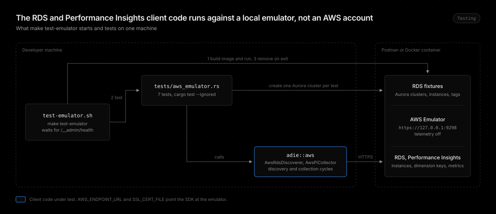

# Development

```bash
make build          # Debug build
make release        # Optimized release build
make test           # Run tests
make test-emulator  # Run the RDS and Performance Insights tests against a local AWS Emulator
make coverage       # llvm-cov report
make fmt            # Format code
make lint           # Run clippy
```

The crate is a library (`src/lib.rs`) with a thin `adie` binary on top, so integration tests in `tests/` reach the same modules the binary runs.

## AWS Emulator tests

`tests/aws_emulator.rs` calls the real RDS and Performance Insights client code against [AWS Emulator](https://github.com/aws/aws-emulator) instead of AWS. The tests are ignored by plain `cargo test`, so the coverage gate is unchanged. `make test-emulator` builds the emulator image from `tests/aws-emulator/Dockerfile`, starts it with Podman or Docker (set `CONTAINER_ENGINE` to choose), runs the tests, and removes the container. It needs no AWS account and no AWS CLI, and the emulator runs with telemetry off.



Each test creates its own Aurora cluster and narrows discovery to it with an identifier filter, so the tests run in parallel against one emulator account.

| Test | Covers |
| --- | --- |
| `discovery_maps_every_instance_field` | `DescribeDBInstances` mapping: resource ID, engine, cluster, class, Performance Insights flag, tags |
| `discovery_cycle_applies_every_filter` | Engine, Performance Insights, identifier include and exclude, and tag filters, plus exported tags |
| `discovery_cycle_reports_deleted_instances` | A deleted instance leaves the published list and is reported as removed |
| `discovery_follows_the_pagination_marker` | 25 instances read in pages of 20 |
| `dimension_keys_are_accepted_for_every_group` | `DescribeDimensionKeys` for every group on Aurora MySQL and Aurora PostgreSQL |
| `collection_cycle_settles_the_up_metric` | A collection cycle ends with `aurora_dbinsights_up` set and API errors counted |
| `resource_metrics_errors_keep_the_service_error_code` | A failed `GetResourceMetrics` keeps the service error code |

### Emulator limits

- Grouped `GetResourceMetrics` and `GetDimensionKeyDetails` are scaffolded in the emulator but not implemented, and `DescribeDimensionKeys` returns no keys. The emulator tests therefore cover discovery fully and the collection failure path, while the unit tests in `src/aws/collector.rs` cover the collection success path with a mocked `PiCollector`.
- The emulator allows 40 DB instances per region, so the pagination test runs in its own region and lowers the page size with `AwsRdsDiscoverer::with_page_size`.

## Conclusion

`make test`, `make fmt`, and `make lint` are the checks a change has to pass, and the pre-commit hook runs them for changed crates. Run `make test-emulator` after touching `src/aws/`.
