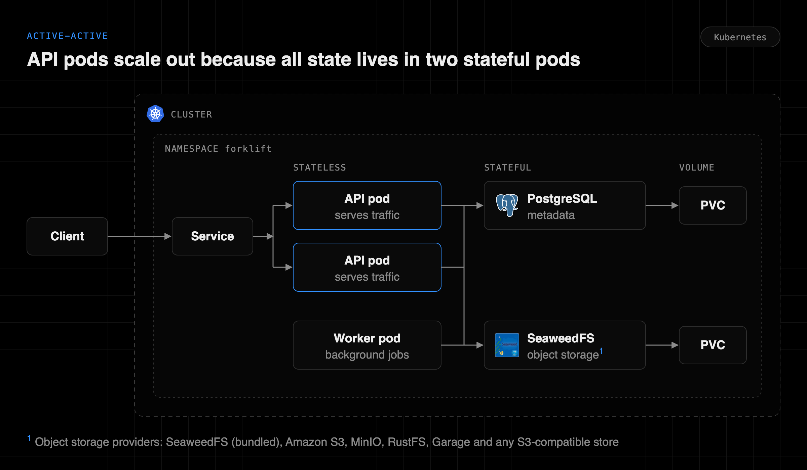

# forklift

[](https://www.rust-lang.org/)
[](https://github.com/younsl/ct/pkgs/container/forklift)
[](https://github.com/younsl/ct/pkgs/container/charts%2Fforklift)
[](https://github.com/younsl/ct/blob/main/LICENSE)

Lightweight, Kubernetes-native artifact repository. One static Rust binary hosts and proxies Maven, npm, Cargo, Go module, PyPI and OCI (container image and Helm chart) artifacts, with a web console, OIDC login and supply-chain policy gates. A focused alternative to heavyweight JVM-based repository managers.

<p align="center"></p>

Diagram source: [architecture-active-active.svg](docs/assets/architecture-active-active.svg)

## Features

- Hosted, proxy and group repositories for six formats
- Supply-chain gates on every proxy request: package age, approval, version denies, vulnerabilities and licenses
- Content-addressed blobs on a volume or S3, metadata in embedded SQLite or PostgreSQL
- One pod, a leader with standbys, or every pod active, picked by one chart value
- Keycloak OIDC, role-based access per repository and scoped access tokens
- Scratch image for amd64 and arm64, Prometheus metrics, audit log, OpenAPI docs and an MCP server

## Quick Start

The recommended installation method is the [Helm chart](https://helm.sh/docs/topics/charts/), distributed as an [OCI artifact](https://helm.sh/docs/topics/registries/) on GitHub Container Registry. The same command installs the release and upgrades it later.

```bash
helm upgrade --install forklift oci://ghcr.io/younsl/charts/forklift \
  --namespace forklift --create-namespace \
  --set auth.bootstrap.adminPassword=change-me
```

This runs a leader and a standby on the bundled SeaweedFS. Other storage layouts are in [Installation](docs/installation.md), and running every pod active is in [Active-active](docs/active-active.md). Then point a client at a repository, for example `registry=http://forklift/npm/npm-public/`.

## Documentation

Detailed guides for setup, operations and design live under docs/.

- [Installation](docs/installation.md)
- [Active-active](docs/active-active.md)
- [Configuration](docs/configuration.md)
- [Architecture](docs/architecture.md)
- [Usage](docs/usage.md)
- [Access control](docs/access-control.md)
- [Security policies](docs/security-policies.md)
- [License scanning](docs/license-scanning.md)
- [Security insights](docs/security-insights.md)
- [Coverage](docs/coverage.md)
- [Metrics](docs/metrics.md)
- [Metadata sync](docs/metadata-sync.md)
- [Storage migration](docs/storage-migration.md)
- [MCP server](docs/mcp.md)
- [Development](docs/development.md)
- [Browser tests](docs/testing/e2e-plan.md)
- [Talks](docs/talks.md)
- [Changelog](CHANGELOG.md)
- [Helm chart values](charts/forklift)

## License

This project is licensed under the Apache License 2.0. See the [LICENSE](../../../LICENSE) file for details.

## AI Disclosure

The entire codebase of this project was developed with the assistance of [Claude Opus 5.5](https://www.anthropic.com/claude/opus) (High effort).
