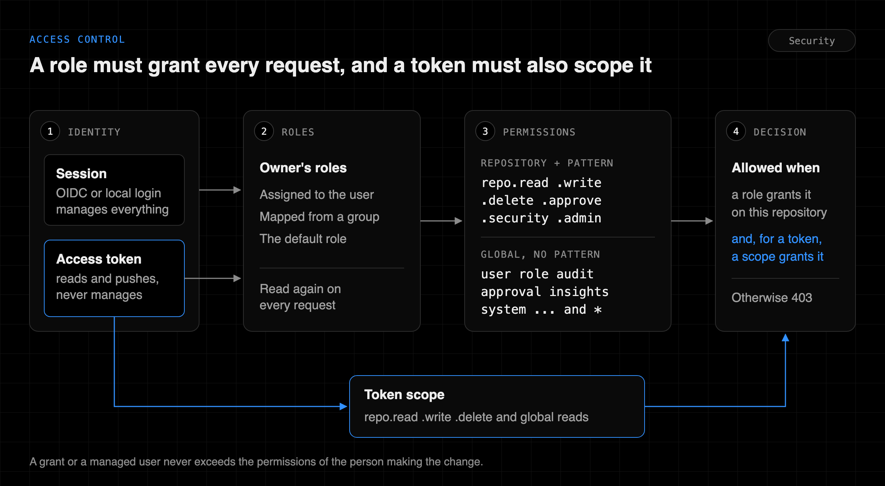

# Access control

## Overview

This document explains how forklift decides what a caller may do: the permission catalog, how roles reach users, how to declare roles and grants in the chart, and what a personal access token can and cannot carry.

Read this when granting a team access, when separating security duties from repository administration, or when issuing tokens for CI and agents.

## Background

Every request arrives as one of three identities: a session from OIDC login, a session from a local account, or a personal access token. Authorization is the same for all three and is role-based. A role carries permissions, and every permission is named `<category>.<verb>`.

Two kinds of permission exist. Repository permissions (`repo.*`) apply to repositories whose name matches a glob pattern. Every other permission is global: it applies to the whole instance and carries no pattern. Keeping the two apart is what lets a security team read users and audit logs without repository administration, and lets a team lead administer `team-a-*` without touching anyone else's repositories.

Roles and grants can be declared in the chart and reconciled on startup, the way [Argo CD](https://github.com/argoproj/argo-cd) handles its RBAC policy, so access can live in Git alongside the rest of the deployment.

<p align="center"></p>

Diagram source: [permission-check.svg](assets/access-control/permission-check.svg)

## Permission catalog

| Permission | Scope | Grants | Token |
| --- | --- | --- | --- |
| `repo.read` | Repository | Pull, browse, search, read labels | Yes |
| `repo.write` | Repository | Push, upload, yank | Yes |
| `repo.delete` | Repository | Delete artifacts and publications | Yes |
| `repo.approve` | Repository | Decide package approvals, add and remove version denies | No |
| `repo.security` | Repository | Edit the security policy through `PUT /api/v1/repositories/{id}/security` | No |
| `repo.admin` | Repository | Every `repo.*` permission, plus repository settings, upstream credentials, disabling, deleting, bulk deletes, labels, and creating a repository whose name matches | No |
| `user.read` | Global | List users and their tokens | Yes |
| `user.write` | Global | Manage users, role assignments and their tokens, impersonate | No |
| `role.read` | Global | List roles, permissions and group mappings | Yes |
| `role.write` | Global | Manage roles, permissions and group mappings | No |
| `audit.read` | Global | Repository audit logs, repository permissions and token listings | Yes |
| `approval.read` | Global | Approval queue and version-deny list | Yes |
| `notification.read` | Global | List notification receivers | Yes |
| `notification.write` | Global | Manage receivers, send test and sample alarms | No |
| `coverage.read` | Global | Coverage settings, CI definitions, alarm preview and history | Yes |
| `coverage.write` | Global | Coverage settings, scans, mutes, GitLab checks, sending the report | No |
| `insights.read` | Global | The full insights report, account and token findings included | Yes |
| `insights.write` | Global | Refresh insights, change their settings, acknowledge checks, send alarms | No |
| `system.read` | Global | HA and storage status | Yes |
| `system.write` | Global | HA step-down, the site-wide announcement | No |
| `*` | Everything | Every permission on every repository | No |

A repository permission is checked against the repository a request touches. Surfaces that span repositories, such as the approval queue, open for a principal holding the permission on at least one pattern, and each decision is still checked per repository.

`repo.security` edits the policy that approval decisions are measured against: age, approval, vulnerability, license, IP ACL, notification receivers and public visibility. The upstream URL and its credentials stay with `repo.admin`, so a security engineer can tighten policy without gaining control over where packages come from.

A group repository serves its members without checking them again, so creating or editing a group needs `repo.admin` on the group and on every member.

`repo.admin` includes the upstream URL and its credentials, so whoever holds it on a pattern can point a proxy repository, and the upstream reachability check, at any address the forklift pods can reach. Grant it to people trusted with outbound access from the cluster.

Delegated access management never reaches beyond the delegate. `role.write` grants only permissions the caller holds itself (`team-*` covers `team-a-*` but not `*`, and only `*` grants `*`), and assigning a role or mapping a group to one needs the same. `user.write` acts only on users whose permissions the caller holds as well: resetting a password, issuing or revoking their tokens, impersonating or deleting them.

Artifact labels are the one write that no read or write permission grants: they may be changed with `repo.admin` on the repository, or by the principal recorded as having uploaded that artifact. Every attempt, refused ones included, is recorded in the repository's audit log.

Roles reach principals two ways: assigned directly to a user, or mapped from a [Keycloak](https://github.com/keycloak/keycloak) group claim. A user with no matching grant has no access unless a default role is configured.

Two switches open reads to callers with no matching grant. `FORKLIFT_ANONYMOUS_READ` allows unauthenticated downloads instance-wide. The per-repository Visibility toggle (Settings tab, `config.public`, Harbor-style) does the same for one repository: anyone, anonymous or authenticated without a grant, may download from a public repository, while writes and deletes always require an authenticated principal with `repo.write` or `repo.delete`. New repositories are private by default.

## Declarative RBAC (chart)

`auth.rbac.policy` is an ArgoCD-style policy reconciled on every startup. It is authoritative for the roles, grants and group mappings it defines (managed rows): removing an entry removes it from the database on the next restart, while UI-created rows survive. Roles, grants and group mappings created in the UI or API coexist with it: declarative entries are read-only in the UI, interactive ones are left untouched.

A permission line names the category and the verb in two fields. Repository permissions take a repository glob as the object, global permissions take `*`, and `*, *, *` grants everything.

```csv
# p, <role>, <category>, <verb>, <object>, allow
# g, <subject>, <role>        (subject: group:<keycloak-group> | user:<name> | bare = user)
p, readonly, repo, read, *, allow
p, developer, repo, read, team-a-*, allow
p, developer, repo, write, team-a-*, allow
p, team-lead, repo, admin, team-a-*, allow
p, auditor, audit, read, *, allow
p, auditor, user, read, *, allow
p, platform, *, *, *, allow
g, group:/platform-admins, platform
g, user:alice, developer
```

- `auth.rbac.policyDefault` (default `readonly`) is the role granted to every authenticated user, even with no explicit grant. Set it empty for deny-all.
- `auth.rbac.accounts` provisions local (password) accounts. Each password is generated into the chart Secret (key `local-user-<name>-password`) and preserved across upgrades. Grant them roles with `g, user:<name>, <role>` lines. Existing accounts (including the bootstrap admin) are never overwritten.
- Out of the box the chart ships a `readonly` role (`repo.read` on every repository), an `auditor` role, and `policyDefault: readonly`. The bootstrap admin receives an `administrator` role holding `*`.

## Personal access tokens

A token's scopes use the same catalog and the same entry rule as roles: one entry holds either `repo.*` permissions on a pattern or global permissions with no pattern. A token may carry only `repo.read`, `repo.write`, `repo.delete` and the global `*.read` permissions. Decisions, administration and global writes stay with a signed-in session, so a leaked CI token cannot approve a package, edit policy or manage accounts.

A token never exceeds its owner: every request needs both the owner's roles and the token's scopes to allow it, and the roles are read again on every request, so demoting or disabling the owner takes effect at once.

A token cannot manage tokens. Issuing, editing and revoking tokens needs a signed-in session, so a leaked token cannot mint a wider or longer-lived one. A token whose scopes are empty or unreadable is rejected.

## Upgrading from the previous action names

Releases before the catalog used seven bare actions on a repository pattern. On startup forklift rewrites every stored role permission and token scope once, and the policy parser still reads the old lines with a warning:

| Before | After |
| --- | --- |
| `read`, `write`, `delete`, `approve`, `security` on a pattern | The matching `repo.*` permission on the same pattern |
| `admin` on `*` | `*` |
| `admin` on another pattern | `repo.admin` on that pattern |
| `audit` | `audit.read`, `user.read`, `role.read`, `approval.read`, `notification.read`, `insights.read` |
| `security` | Also `insights.read` and `insights.write`, which it used to open |

Tokens keep only what a token may carry. A token left with no scopes is rejected, and the security insights list it for revocation.

## Related documents

- [Configuration](configuration.md) for the `FORKLIFT_RBAC_*` and OIDC environment variables.
- [Security policies](security-policies.md) for what `repo.approve` and `repo.security` govern.
