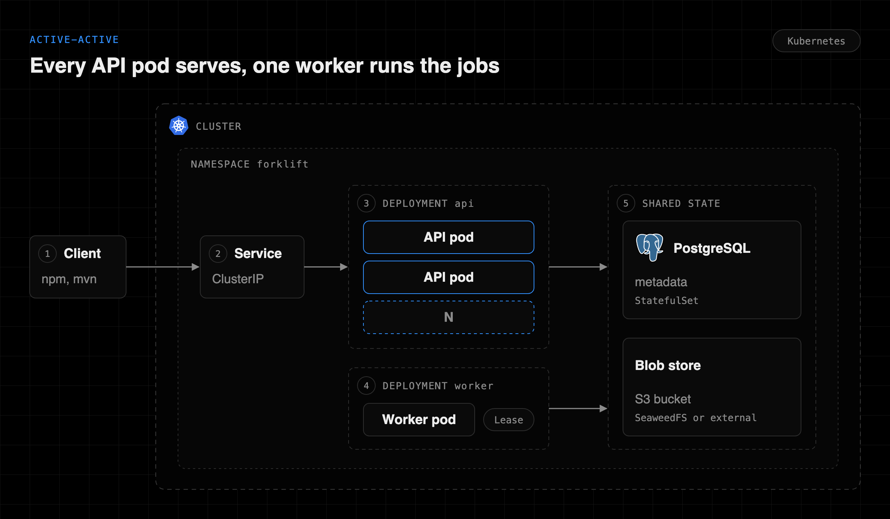

# Active-active

## Overview

This document explains how to run forklift with every pod serving requests at once. It covers the installation modes, the PostgreSQL metadata store that makes it possible, what each kind of pod does, and how to scale back to one pod without losing data.

Read this when one serving pod is no longer enough, or when choosing a topology for a new install. The reasoning behind the design is in [designs/active-active-postgres.md](designs/active-active-postgres.md).

## Background

<p align="center"></p>

Diagram source: [architecture.svg](assets/active-active-postgres/architecture.svg)

SQLite accepts one writer, so the default layouts elect a leader and only the leader serves. With PostgreSQL every pod reads and writes the same database and blob store, and the Lease only picks the worker that runs the background jobs.

## Installation modes

`installationMode` is one value that picks the topology and supplies the settings that depend on it. Leave it empty to keep the layout derived from `replicaCount`, `ha`, `replication` and `storage`, which is how the layouts in [Installation](installation.md) work.

| `installationMode` | Server pods | Metadata | Who serves | Leader election |
| --- | --- | --- | --- | --- |
| `standalone` | 1 | SQLite | the pod | none |
| `activePassive` | at least 2 | SQLite | the leader | gates traffic |
| `activeActive` | `replicaCount` API pods plus `worker.replicaCount` workers | PostgreSQL | every API pod | picks the worker that runs background jobs |

The blob store follows the storage settings in every mode, so the bundled SeaweedFS stays on unless you turn it off. The chart rejects combinations that cannot work, for example `activeActive` with `database.type=sqlite` or PostgreSQL with `replication.enabled`.

## Install

SQLite accepts one writer, so the layouts above keep one serving pod and the rest on standby. With PostgreSQL as the metadata store every pod serves requests, and the pods only need a blob store they all share: the s3 backend or a ReadWriteMany volume.

One value is enough to try it. It renders two API pods, one worker, a bundled PostgreSQL and the bundled SeaweedFS:

```bash
helm install forklift oci://ghcr.io/younsl/charts/forklift \
  --namespace forklift --create-namespace \
  --set installationMode=activeActive \
  --set auth.bootstrap.adminPassword=change-me
```

The bundled PostgreSQL is a single pod with no failover, deployed from the chart's own templates. While it is down, forklift is down, however many API pods there are. For production point the chart at a server you run for availability (a managed service or an operator such as CloudNativePG):

```bash
helm install forklift oci://ghcr.io/younsl/charts/forklift \
  --namespace forklift --create-namespace \
  --set installationMode=activeActive \
  --set database.type=external \
  --set database.external.host=postgres.example.com \
  --set database.external.existingSecret=forklift-postgres \
  --set seaweedfs.enabled=false \
  --set storage.backend=s3 \
  --set storage.s3.bucket=my-forklift-bucket \
  --set auth.bootstrap.adminPassword=change-me
```

- The API pods (`FORKLIFT_TARGET=api`) serve the UI, the API and the package endpoints. The worker (`FORKLIFT_TARGET=worker`) runs blob garbage collection, retention, scans and notifications, and receives no client traffic.
- The schema is created on first start. Pods starting together take turns through an advisory lock.
- Under a GitOps tool that renders without cluster access, set `database.internal.password` explicitly. A generated password changes on every render, and the bundled server only reads it when its volume is first initialized.
- Each pod opens `database.maxConnections` sessions (16 by default). Keep the total under the server's `max_connections`.
- There is no automatic move of an existing SQLite install to PostgreSQL yet. A new PostgreSQL install starts empty.

## What runs where

| Pod | `FORKLIFT_TARGET` | Serves | Runs |
| --- | --- | --- | --- |
| API | `api` | UI, management API, package endpoints | its own scan and license queues |
| Worker | `worker` | nothing, no Service selects it | blob garbage collection, retention, reference count check, OCI pruning, scan backfill, coverage schedule, security insights, notifications |
| Database | | PostgreSQL on port 5432 | bundled only, one pod |

- The Service spreads requests over the API pods. A session cookie from one pod is valid on the others, since they share the signing secret.
- Several workers are allowed. One holds the Lease and works, the others wait and take over when it goes away. API pods keep serving while the Lease moves.
- Without a mode, PostgreSQL with `replicaCount: 2` runs both pods as `all`: both serve, and the Lease holder also runs the background jobs.

## Scaling back to one pod

`database.type` is derived from the mode when it is empty, so the database has to stay explicit when the mode changes. To go from `activeActive` to a single pod and keep the data:

```yaml
installationMode: standalone
database:
  type: internal   # or external, whatever the release already uses
```

One pod then serves and runs the background jobs, and the worker Deployment is removed. Changing only `installationMode` would resolve the database to SQLite: forklift would start on an empty metadata store, the bundled PostgreSQL would be removed (its volume claim stays), and the blobs in the bucket would no longer be referenced. `helm upgrade` refuses that render when the release already runs on PostgreSQL, and `database.type=sqlite` confirms it. The check needs cluster access, so a tool that renders without it (`helm template`, Argo CD) does not get it. Pin `database.type` in the values there.

## Limits

- The bundled PostgreSQL has no failover. Availability of the whole install is that of this one pod.
- Writes other than artifact uploads are serialized across all pods by a database lock. Reads and artifact writes run in parallel.
- A blob store shared by every pod is required: the s3 backend or a ReadWriteMany volume. The chart refuses to render several pods on PostgreSQL without one.
- PV replication and metadata sync to S3 are SQLite features and do not run on PostgreSQL.
- An upload of content identical to a blob the worker is deleting at that moment fails once and succeeds on retry.

## Related documents

- [Installation](installation.md) for the SQLite layouts and storage setup.
- [Configuration](configuration.md) for `FORKLIFT_DATABASE_*` and `FORKLIFT_TARGET`.
- [Architecture](architecture.md) for how the layouts differ on failover.
- [Metrics](metrics.md) for which metrics come from API pods and which from the worker.
- [designs/active-active-postgres.md](designs/active-active-postgres.md) for the design, the write contention safeguards and what was verified.
