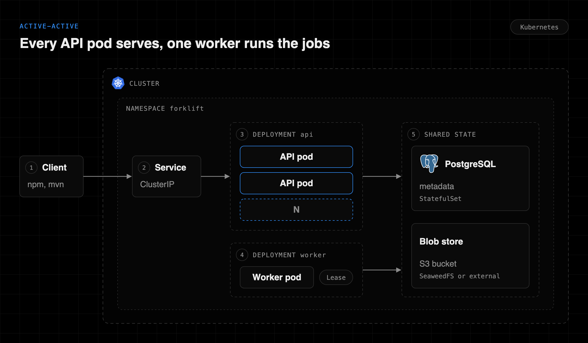

# Active-active API pods on PostgreSQL

| Status | Category |
| --- | --- |
| proposed, not implemented (verified against `main` at `9cd35349`, 2026-11-15) | storage, topology |

This design lets every forklift pod serve requests at once by adding PostgreSQL as an opt-in metadata backend, and moves background jobs to a single worker in the style of a compactor. SQLite stays the default and keeps today's leader-based layouts unchanged.

## Why

forklift scales to one active pod. Metadata lives in embedded SQLite, which accepts one writer, so a Lease elects a leader and only the leader receives traffic. The standby adds availability, not capacity.

Blobs are not the limit. They are content addressed by SHA-256 and immutable, so with the s3 backend any pod can read and write them without coordination. Only the metadata store prevents a second active pod.

## Goals

- Every API pod is Ready and serves reads and writes against the same storage.
- No external dependency for the default install. PostgreSQL is opt-in.
- Package client URLs and the `/api/v1` contract do not change.
- One binary and one image. Roles are selected by a flag.

## Non-goals

- A separate web pod. The embedded SPA stays in the API pod, see [Web pod](#web-pod).
- A hash ring or any pod-to-pod membership protocol, see [Why no hash ring](#why-no-hash-ring).
- Sharding metadata by repository.
- Replacing the SQLite layouts or the WAL shipping path.

## Decision

| Option | Result |
| --- | --- |
| PostgreSQL metadata plus a shared blob store | Chosen. Same shape as Nexus, Artifactory, Harbor and Grafana HA. |
| Standby serves reads, writes forwarded to the leader | Rejected. Write throughput stays at one pod, and replication lag breaks publish-then-fetch. |
| Per-repository SQLite shards owned through a hash ring | Rejected. `blobs.ref_count` is global, search and group repositories span shards, and one hot proxy repository still lands on one pod. |
| SQLite file on a shared RWX volume | Rejected. WAL mode needs shared memory on one host. |

Nexus and Artifactory both shipped clustering on an embedded database and later dropped it for an external one. No surveyed project runs active-active on embedded SQLite.

## Architecture

<p align="center"></p>

Source: [architecture.svg](../assets/active-active-postgres/architecture.svg).

```
SQLite mode (default, unchanged):
client  ->  Service  ->  leader pod (target=all)  ->  SQLite + blobs
                         standby pod              (takes over on failover)

PostgreSQL mode:
client  ->  Service  ->  api pod 1..N (target=api)  --+-->  PostgreSQL (metadata)
                                                      +-->  S3 or RWX volume (blobs)
                         worker pod (target=worker) --+
                         (Lease holder runs the background jobs)
```

### Metadata backends

| Metadata | Blobs | Active pods | Notes |
| --- | --- | --- | --- |
| SQLite | PV or S3 | 1 | Today's layouts |
| PostgreSQL | S3 | N | Recommended |
| PostgreSQL | RWX volume | N | Works without S3 |
| PostgreSQL | RWO volume | 1 | Rejected at startup when replicas exceed one |

PostgreSQL mode needs a blob store that every pod shares. S3 is the usual choice and is not strictly required.

### Targets

A `--target` flag with an env fallback selects what a process runs.

| Target | Serves requests | Runs background jobs | Used by |
| --- | --- | --- | --- |
| `all` (default) | yes | yes, when it holds the Lease | SQLite mode, small PostgreSQL installs |
| `api` | yes | no | PostgreSQL mode |
| `worker` | health and metrics only | yes, when it holds the Lease | PostgreSQL mode |

Background jobs are the work the leadership callbacks own today: retention and cache eviction, blob garbage collection, the idle reaper, OCI upload and tag pruning, coverage scans, security insights, license and vulnerability scans, notifications, audit pruning, and applying declarative state (bootstrap admin, chart RBAC policy, seeded repositories). In PostgreSQL mode the Lease no longer gates readiness or routing. It only picks which worker runs these jobs.

### Why no hash ring

A hash ring assigns ownership of state that lives inside a pod. In PostgreSQL mode pods hold no state, so there is nothing to own.

| Ring duty in Loki or Mimir | Replacement here |
| --- | --- |
| Pick the pod that owns a key | Any pod serves any request |
| Prevent conflicting writes | Transactions, unique constraints, `ON CONFLICT` |
| Elect a singleton | The existing Lease |
| Spread jobs over several workers | A job table read with `FOR UPDATE SKIP LOCKED`, only if one worker stops being enough |

A ring becomes relevant again only if pod-local state returns, such as per-repository SQLite shards or a pod-local blob cache that wants cache-aware routing.

### Web pod

The SPA is static, already precompressed, and costs almost nothing to serve, so splitting it does not help capacity. Argo CD, Grafana, Zot, Nexus and Artifactory all keep the UI with the API. The split stays possible later since the coupling is one module (`crates/forklift/src/webui.rs`) and one fallback route, and the frontend calls only relative paths. [fe-be-pod-split.md](fe-be-pod-split.md) describes an older Next.js variant and is not part of this design.

## Required changes

### Store abstraction

`meta::Store` is a concrete rusqlite type referenced from 56 places, with about 210 query closures across `crates/forklift/src/meta` (13,203 lines with tests, 49 migrations, about 36 tables). It becomes a trait with two implementations.

SQLite-specific SQL is limited: `AUTOINCREMENT` keys, `rowid`, `datetime` and `strftime`, one `json_each`, one `GLOB`, one `INSERT OR REPLACE`. Search does not use FTS5. Timestamps are stored as RFC 3339 text and can stay text in the first PostgreSQL schema to keep the two implementations close.

PostgreSQL gets its own migration set. The PostgreSQL client must build statically with rustls and no openssl.

### Pod-local state

| State | Today | Change |
| --- | --- | --- |
| OCI chunked upload sessions | Bytes staged under `<data_dir>/oci-uploads/<session>` on the pod | Stage in the shared blob store (S3 multipart or the RWX volume), or a follow-up chunk routed to another pod fails |
| UI upload staging | Staged as content-addressed blobs with a database lease | None |
| Token `last_used_at` | Written on every token-authenticated request | Throttle like artifact access, which already skips writes within 5 minutes |
| Audit log and download counters | Batched (256 events or 5 seconds) | None |
| OSV lookup cache, regex and semaphores | In memory per pod | None. Concurrency limits become per pod, so the total is N times the setting |
| RBAC and repository config read by handlers | Read from the store | Any in-memory copy needs a short TTL or `LISTEN/NOTIFY` |
| Concurrent proxy cache fill of one artifact | Cannot happen with one active pod | Accepted. Blobs are content addressed and the index write is an upsert, so the only cost is a duplicate upstream fetch |

### Write contention between blobs and metadata

Two guards that hold today are local to one process and stop working with several active pods.

| Guard today | With several active pods |
| --- | --- |
| Atomic blob write (temp file, then rename or one PutObject to the digest key) | Holds. Two pods writing one digest write identical bytes |
| Bytes first, metadata second | Holds |
| `UNIQUE(repo_id, path)` with upsert | Holds |
| `ref_count = ref_count + ?` in one statement | Holds |
| 24 hour GC grace on `unreferenced_since` and `created_at` | Holds, not sufficient alone |
| Guarded record delete before the byte delete | Holds |
| `gc_mu` RwLock: four write paths take the read guard, the sweeper takes the write guard per digest | Broken. The lock lives in one process |
| SQLite's single writer serializing every write | Gone |

Two races follow.

- GC against upload, which loses data. The worker deletes the record of a digest that has been unreferenced past the grace period. An API pod then stores the same content, finds or writes the bytes, and inserts a fresh record with a reference. The worker then deletes the bytes, and a live artifact points at nothing.
- Concurrent publish of one path, which corrupts reference counts. Two pods overwrite the same `(repo_id, path)`, both read the old blob, and both decrement it. The old blob drops to zero while another path still references it and becomes a GC candidate.

PostgreSQL mode replaces the two broken guards.

| Safeguard | Replaces | How |
| --- | --- | --- |
| GC in one transaction | `gc_mu` write guard | The sweeper runs the guarded `DELETE`, deletes the bytes, then commits. The row lock covers the window between the two deletes |
| Reserve before bytes | `gc_mu` read guard | Once the digest is known and before the existence check or upload, the writer upserts the blob row and resets `unreferenced_since` to now. A reservation that commits first makes the sweeper's guard miss. A sweeper that locks first makes the reservation wait until the bytes are gone, and the writer then uploads them again |
| Per-path advisory lock | Single writer | `put_artifact` and the delete paths take `pg_advisory_xact_lock` on a hash of `(repo_id, path)` at the start of the transaction. It also covers a new path, where no row exists to lock, and check-then-insert rules such as redeploy protection |
| Reference count reconciliation | None, new | The worker periodically recomputes `ref_count` from `artifacts` and exports the mismatch count as a metric |

Both blob backends already learn the digest from a local temp file before anything lands at the digest key, so the reservation fits between hashing and the upload. `BlobStore::put` has to expose that point, since today it also skips the upload when the key already exists.

The Lease is not a strict fence, so two workers can briefly both believe they lead. The guarded `DELETE` is atomic in PostgreSQL, the second worker matches no row, and it leaves the bytes alone.

### Not needed in PostgreSQL mode

Metadata sync (`objstore/metasync`, WAL shipping), PV replication, snapshot restore on promotion, S3 fencing, and leader pod labels are skipped. The failover data-loss window of the SQLite layouts does not apply, since durability is PostgreSQL's.

### Chart

- A `database.type` value selects the metadata backend: `sqlite` (default), `internal`, or `external`.
- A worker Deployment rendered when the worker target is enabled.
- In PostgreSQL mode the Service selects all API pods and the leader label and headless Service are not rendered.
- Schema validation rejects PostgreSQL with `replication.enabled` and rejects more than one replica on an RWO volume.
- `values.schema.json` is updated in the same commit.

### Bundled PostgreSQL

The chart ships its own PostgreSQL templates under `templates/database/`, the way the Harbor chart does, instead of a subchart. A subchart ties the release to a third-party chart's image and licensing policy, and forklift needs only a small part of what such a chart offers.

| `database.type` | Rendered | Use |
| --- | --- | --- |
| `sqlite` | Nothing. Today's layouts | Default |
| `internal` | StatefulSet with one replica, PVC, Service, Secret | Evaluation and small installs |
| `external` | Nothing. forklift connects to `database.external.*` | Production |

- `internal` runs the official PostgreSQL image at a pinned version. An empty password generates one into the chart Secret, like the session secret.
- `internal` is one instance and is not highly available. With several API pods it is the single point of failure, so availability can be worse than the SQLite leader layouts. The chart notes say so.
- `external` reads the password from an existing Secret and exposes host, port, database, user, and TLS mode.
- The bundled SeaweedFS stays a subchart, so the chart mixes both styles on purpose.

## Rollout

1. Throttle `touch_token`. Useful in SQLite mode by itself.
2. Turn `meta::Store` into a trait with the SQLite implementation only. No behavior change.
3. Add the `--target` flag and move background jobs behind it. SQLite mode keeps `all`.
4. Move OCI upload staging to the shared blob store.
5. Add the PostgreSQL implementation, its migrations, and the chart values.
6. Add a one-shot SQLite to PostgreSQL migration, following the existing storage migration Job.

Steps 1 to 4 ship without PostgreSQL and each one is independently releasable.

## Risks

| Risk | Mitigation |
| --- | --- |
| Two implementations drift | One shared test suite run against both backends in CI |
| PostgreSQL availability is now forklift's availability | `external` is the production path and is the operator's responsibility (managed service or an operator such as CloudNativePG). `internal` is documented as a single instance |
| Connection count grows with pods | Bounded pool per pod, PgBouncer for large installs |
| Query plans differ from SQLite on large indexes | Load test with a production-sized artifact index before release |
| A transaction that relied on the single writer for isolation | Audit every multi-statement write for explicit transactions and row locks during step 5 |

## Open questions

- PostgreSQL client crate: `tokio-postgres` with `deadpool-postgres` keeps hand-written SQL close to the rusqlite code. `sqlx` adds compile-time checks at the cost of a second query style.
- Whether the worker also serves requests in small installs, which is what target `all` does, or whether the chart always renders a dedicated worker.
- Which check-then-insert rules besides redeploy protection rely on the single writer today and need the per-path lock.
- Whether holding a transaction open across one blob delete per digest is acceptable on a slow object store, or whether the sweeper needs a tombstone state instead.

## Validation

- The existing integration suite passes against both backends.
- Two API pods under concurrent publish and fetch of the same coordinates return no 404 after a successful publish.
- An OCI chunked push succeeds with each chunk sent to a different pod.
- Uploading content whose digest the sweeper is reclaiming on another pod leaves the artifact readable.
- Concurrent overwrites of one path from two pods leave every `ref_count` equal to the number of artifact rows that reference the blob.
- Killing the worker moves the Lease and background jobs resume, while API pods keep serving.
- SQLite mode renders the same manifests as before the change.
