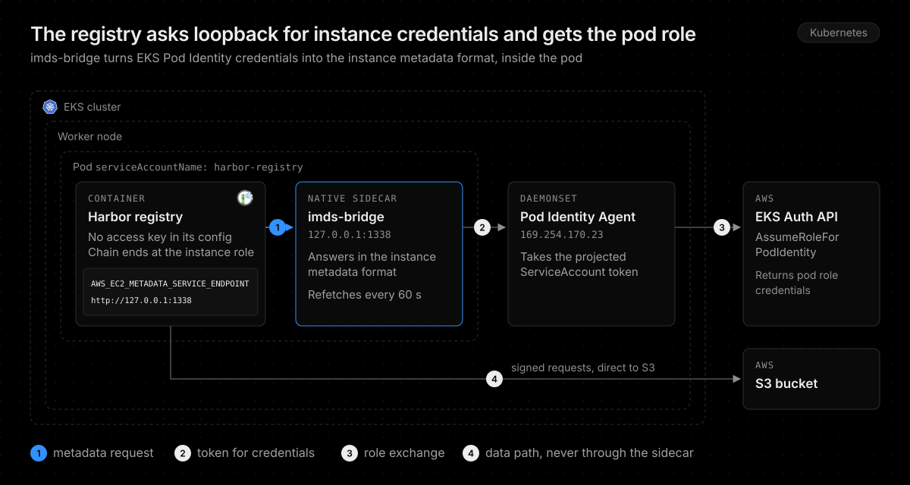

# imds-bridge

[](https://github.com/younsl/ct/pkgs/container/imds-bridge)
[](https://www.rust-lang.org/)
[](https://github.com/younsl/ct/blob/main/LICENSE)

A [sidecar container](https://kubernetes.io/docs/concepts/workloads/pods/sidecar-containers/) that serves [EKS Pod Identity](https://docs.aws.amazon.com/eks/latest/userguide/pod-identities.html) credentials through an [EC2 instance metadata](https://docs.aws.amazon.com/AWSEC2/latest/UserGuide/ec2-instance-metadata.html) endpoint on loopback. It removes static access keys from applications whose AWS credential chain is hardcoded to static keys, environment variables, the shared credentials file, and the instance role.

## Architecture



The registry container and the sidecar share the pod network namespace, so the instance metadata endpoint exists only on the loopback of that pod. The sidecar is the only container that talks to the Pod Identity Agent on the node, and the registry keeps its direct path to S3.

## Why

Some applications build their own credential chain instead of using the AWS SDK default one. The S3 storage driver of [distribution](https://github.com/distribution/distribution) 2.8, which the [Harbor](https://github.com/goharbor/harbor) registry is built from, is one example. Such a chain ignores both IAM Roles for Service Accounts and EKS Pod Identity, so the only refreshing provider left is the instance role, which grants the node role to the pod.

imds-bridge keeps that provider and replaces what it talks to. The application is pointed at loopback, where the sidecar answers in the instance metadata format with the credentials of the pod role.

## How it works

1. The Pod Identity webhook injects the container credentials URI and the token file into every container of the pod, the sidecar included.
2. A background task in the sidecar reads the token file and fetches credentials from the Pod Identity Agent on the node, every 60 seconds by default.
3. The application asks the sidecar for an IMDSv2 session token, the role name, and the role credentials, exactly as it would ask the real instance metadata service.
4. The application calls AWS directly. Only credentials pass through the sidecar, never data.

The application refreshes by itself, because the instance role provider fetches again when the reported expiration is reached. The sidecar reports an expiration five minutes earlier than the real one, so a client without an expiry window still rotates before the credentials die.

## Usage

Run imds-bridge as a native sidecar (an init container with restart policy Always) so it is ready before the application starts, and set one environment variable on the application container. See [example-pod.yaml](example-pod.yaml) for a full Pod.

```yaml
env:
  - name: AWS_EC2_METADATA_SERVICE_ENDPOINT
    value: http://127.0.0.1:1338
```

Requirements:

- An EKS Pod Identity association for the service account of the pod.
- An application SDK that reads the instance metadata endpoint variable. Verified with the aws-sdk-go 1.55.8 instance role provider, the one the Harbor 2.16.0 registry uses.
- No static keys left in the application config or environment. They sit earlier in the chain and win.

When the sidecar is down, the application fails to get credentials. It does not fall back to the node role, because the endpoint override also hides the real instance metadata service.

## Configuration

Every flag falls back to an environment variable.

| Flag | Environment variable | Default | Description |
| --- | --- | --- | --- |
| `--listen-addr` | `LISTEN_ADDR` | `127.0.0.1:1338` | Instance metadata listener. Only loopback addresses are accepted. |
| `--metrics-addr` | `METRICS_ADDR` | `0.0.0.0:9090` | Listener for health, readiness, and metrics. |
| `--role-name` | `ROLE_NAME` | `imds-bridge` | Role name reported to the application. Cosmetic, it does not select a role. |
| `--credentials-uri` | `AWS_CONTAINER_CREDENTIALS_FULL_URI` | injected | Container credentials endpoint. Plain http to loopback or a container credentials address only. |
| `--authorization-token-file` | `AWS_CONTAINER_AUTHORIZATION_TOKEN_FILE` | injected | Token file sent as the Authorization header. |
| `--refresh-interval-seconds` | `REFRESH_INTERVAL_SECONDS` | `60` | Interval between fetches from the credentials endpoint. |
| `--expiry-margin-seconds` | `EXPIRY_MARGIN_SECONDS` | `300` | Seconds subtracted from the reported expiration. |
| `--log-level` | `LOG_LEVEL` | `info` | Log level. `RUST_LOG` overrides it. |
| `--log-format` | `LOG_FORMAT` | `json` | `json` or `text`. |

## Endpoints

Instance metadata listener (loopback):

| Method | Path | Response |
| --- | --- | --- |
| PUT | `/latest/api/token` | Session token. Requires the token TTL header, rejects forwarded requests. |
| GET | `/latest/meta-data/iam/security-credentials/` | Role name. |
| GET | `/latest/meta-data/iam/security-credentials/{role}` | Credentials document, or 503 when none are valid. |

Both GET paths require the session token header, so IMDSv1 style requests get 401. Every other metadata path returns 404.

Admin listener:

| Path | Description |
| --- | --- |
| `/healthz` | Always 200 while the process runs. |
| `/readyz` | 200 once unexpired credentials are cached. |
| `/metrics` | Prometheus metrics. |

## Metrics

| Metric | Type | Description |
| --- | --- | --- |
| `imds_bridge_requests_total` | Counter | Instance metadata requests by route and status code. |
| `imds_bridge_credential_refreshes_total` | Counter | Fetches from the credentials endpoint by result. |
| `imds_bridge_credentials_expiration_timestamp_seconds` | Gauge | Expiration of the cached credentials. |

## Security

- The metadata listener refuses to bind anything but loopback, so credentials never leave the pod network namespace. Every container in the pod can read them, which is already true for Pod Identity itself.
- The token file is only sent to loopback or the well-known container credentials addresses, the same allowlist the AWS SDKs apply.
- Credentials and tokens are never logged.

## Scope

EKS Pod Identity is the only credential source. IAM Roles for Service Accounts would need an STS client and TLS in the binary, which this component leaves out to stay small.

## Development

See [docs/development.md](docs/development.md) for the build targets and the Harbor registry simulation against AWS Emulator.
