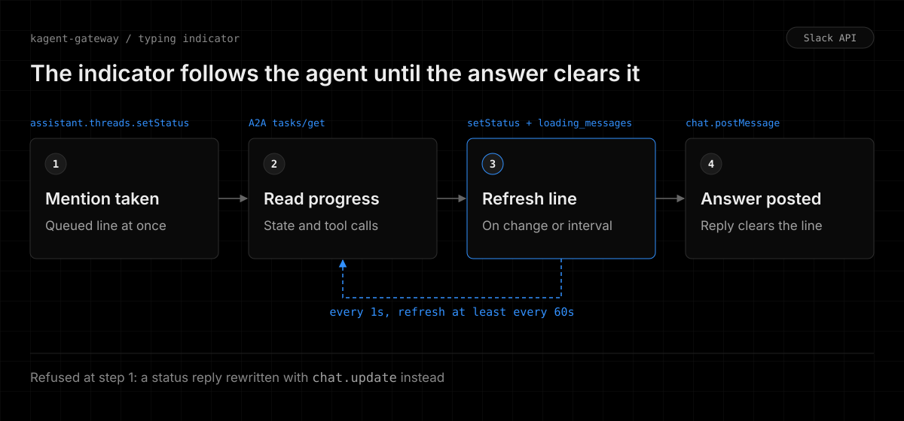

# Slack status indicator

| Status | Category |
| --- | --- |
| implemented in 0.4.1 | integration |

## Summary

While a mention turn runs, the gateway shows Slack's native typing indicator under the thread instead of a status reply rewritten in place. The indicator names the agent, what it is doing (the task state or the tool it runs), and the elapsed time, and ends in one emoji. Nothing lands in channel history during the turn, and the answer is posted as one fresh reply that clears the indicator. It replaces the status message described in [Live status](slack-mention-invocation.md#live-status) as the default, which stays available as `CHAT_STATUS_STYLE=message` and as the fallback.

## Goals

- Show that a mention was taken the moment it is accepted, before a slot is held.
- Show live progress: the queued wait, the A2A task state, and the tool the agent runs.
- Leave nothing in channel history while the agent works, and post the answer without an "(edited)" label.
- Need no scope beyond `chat:write`, which the answer already requires.
- Keep the alert analysis path unchanged.

## Non-goals

- Signalling at channel level. The indicator lives in a thread, so the alert path keeps its reactions and investigating note.
- Streaming the answer text. The answer is posted once, when the turn ends.

## Slack API

The indicator is `assistant.threads.setStatus` with `channel_id`, `thread_ts`, `status`, and `loading_messages`.

| Behavior | Consequence for the gateway |
| --- | --- |
| In a channel thread Slack shows a bare `status` only as a generic "<App> working" label | The text also goes out as the single `loading_messages` entry, which Slack renders as the custom line |
| Slack drops the indicator two minutes after the last call | Refreshed at least every 60s (`INDICATOR_KEEPALIVE`), also while the turn waits for a slot |
| A reply from the app clears the indicator | The answer post is the normal clear. A reply that fails to post clears it explicitly with an empty `status` |
| The method needs only `chat:write` in channel threads | No new scope or app setting |
| `loading_messages` takes 1 to 10 entries, and `invalid_arguments` is documented without a cause | One short entry per call, see [Line format](#line-format) |

## Lifecycle

| Phase | Indicator | Slack call |
| --- | --- | --- |
| Mention accepted | `실행 슬롯을 기다리는 중... ⏳` | `setStatus`. A refusal falls back to the status message for this turn |
| Waiting for a slot | Same line | `setStatus` every 60s |
| Agent running | Working line, see below | `setStatus` on a change, and every `CHAT_STATUS_INTERVAL` (capped at 60s) when unchanged |
| Answer ready | Cleared by the reply | `chat.postMessage` |
| Reply failed | Cleared | `setStatus` with an empty `status` |

The ticker looks at the agent's progress every second (`PROGRESS_CHECK`). A change in the task state or the running tools is shown on the next look, so a turn of 5 to 15 seconds still shows the tools it ran. An unchanged line is refreshed only once `CHAT_STATUS_INTERVAL` has passed, which moves the elapsed time and keeps the indicator alive. The ticker owns the Slack call, so the A2A polling task never waits on Slack. A failed refresh is logged as `failed to refresh the thread status` and costs only that refresh.

## Progress source

The A2A task carries the state (`submitted`, `working`, ...) and the tool call parts kagent records. The gateway reads the latest message that holds tool parts, takes its `function_call` names, and drops the ones a `function_response` in the same message already answered. The part type is matched under the 1.0 metadata key `kagent.dev/a2a/part-type` and the 0.x keys `kagent_type` and `adk_type`. A model that calls several tools in parallel yields all of them, deduplicated, in call order.

## Line format

`{agent} 에이전트가 {phrase}... (경과 {elapsed}) {emoji}`

- The agent is named in full, so a reader knows which agent answers without opening the policy.
- The line reads as an ongoing action (`...하는 중`) and ends in one Unicode emoji tied to the phase.
- Running tools name the first one and count the rest (`MAX_INDICATED_TOOLS = 1`), which keeps the line short however wide the model fans out. The status message still lists up to three (`MAX_LISTED_TOOLS`).

| Activity | Alert thread | Line |
| --- | --- | --- |
| Tools running | either | `aws-alert-triage-agent 에이전트가 prometheus_query 외 2개 도구를 실행하는 중... (경과 11초) 🔧` |
| `submitted` | yes | `... 이 스레드의 알람으로 작업을 시작하는 중... (경과 N초) 🚨` |
| `submitted` | no | `... 작업을 시작하는 중... (경과 N초) 🚀` |
| `working` | yes | `... 이 스레드의 알람을 확인하는 중... (경과 N초) 🔍` |
| `working` | no | `... 답변을 준비하는 중... (경과 N초) 💬` |
| any other state | either | `... 확인하는 중... (상태 {state}, 경과 N초) 🤔` |

The raw task state is a protocol token, so only an unrecognised one is printed, where it helps debugging. The poll count is left out, since it is the elapsed time divided by `KAGENT_POLL_INTERVAL`.

## Fallback

`CHAT_STATUS_STYLE=message` keeps the 0.3 behavior: a `:mag:` status reply posted at once, rewritten with `chat.update`, and ending as the answer. With `assistant` (the default), a turn whose first `setStatus` Slack refuses falls back to the same status message, so the asker always sees the question was taken. A refusal on a later refresh does not switch styles mid-turn.

## Configuration

| Variable | Default | Effect |
| --- | --- | --- |
| `CHAT_STATUS_STYLE` | `assistant` | `assistant` for the indicator, `message` for the rewritten status reply |
| `CHAT_STATUS_INTERVAL` | `10s` | Refresh cadence of an unchanged line. The indicator caps it at 60s |

## Open questions

- Slack returned `invalid_arguments` on one refresh in a live turn, after the first `setStatus` had succeeded. The log does not carry the line, so the cause is not confirmed. A long line listing several tools is the leading suspect, which the one-tool format addresses. Logging the line length on failure would settle it.
