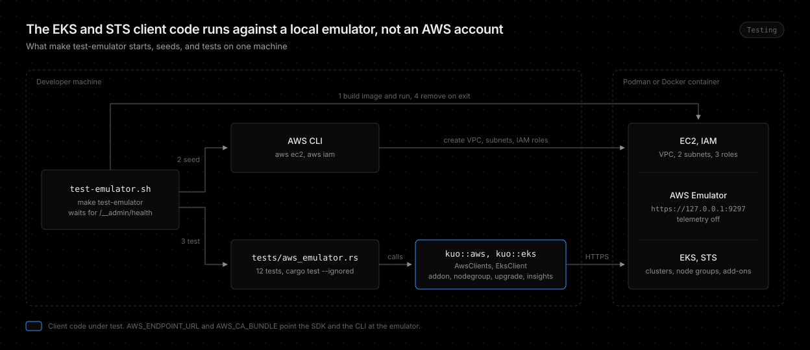

# Development

```bash
make build          # Debug build
make release        # Optimized release build
make test           # Run tests
make test-emulator  # Run the EKS and STS tests against a local AWS Emulator
make fmt            # Format code
make lint           # Run clippy
make install        # Install to ~/.cargo/bin/
make crd            # Regenerate the chart CRD from the Rust types
```

The module layout behind each reconcile is shown below. See [Grafana annotations](grafana-annotations.md#architecture) for how the phase-transition hook drives notifications and annotations.


## CRD

The EKSUpgrade CRD in the chart is generated from `EKSUpgradeSpec` and `EKSUpgradeStatus` in `src/crd/`. Change the Rust types, then run `make crd`, which runs the `crdgen` binary to write the chart template. `crdgen` is a build tool and is not shipped in the image. `cargo test` fails when the chart CRD no longer matches the Rust types.

## AWS Emulator tests

`tests/aws_emulator.rs` calls the real EKS and STS client code against [AWS Emulator](https://github.com/aws/aws-emulator) instead of AWS: describing clusters and version lifecycles, control plane, node group, and add-on updates, upgrade and rollback plans, cluster insights, and the cross-account `AssumeRole` path. The tests are ignored by plain `cargo test`. `make test-emulator` builds the emulator image from `tests/aws-emulator/Dockerfile`, starts it with Podman or Docker (set `CONTAINER_ENGINE` to choose), seeds the subnets and IAM roles a cluster needs with the AWS CLI, runs the tests, and removes the container. It needs no AWS account, and the emulator runs with telemetry off.



## Conclusion

`make test`, `make fmt`, and `make lint` are the checks a change has to pass (`make crd` first when a CRD type changed), and the pre-commit hook runs them for changed crates. Start from the module diagram above to find where a change belongs.
